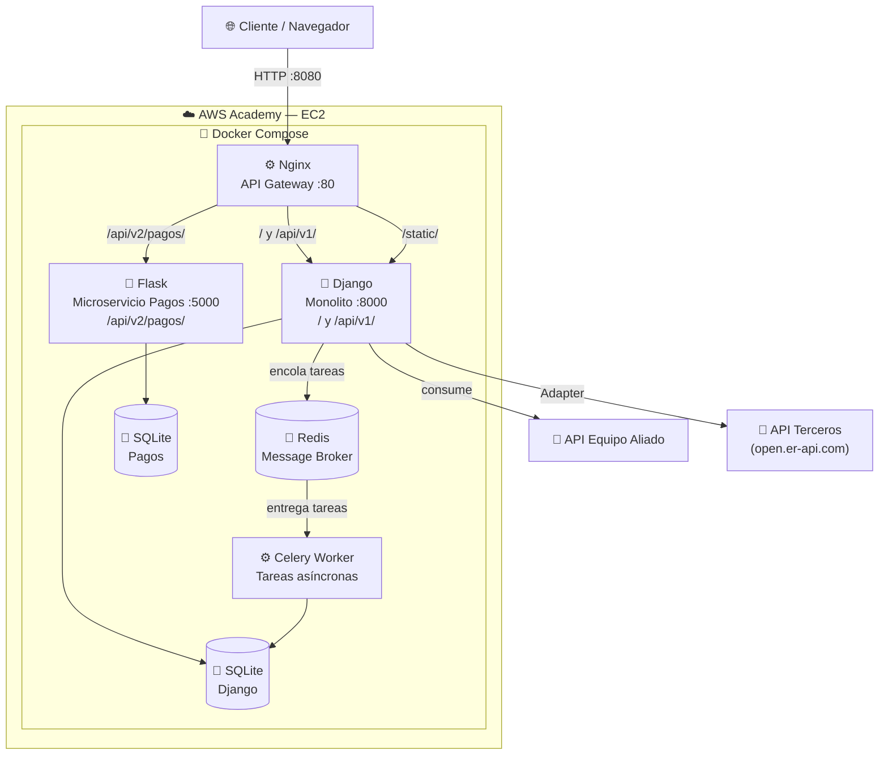

# Arquitectura — Entrega 2

Ecosistema híbrido y resiliente: monolito Django + microservicio Flask,
orquestados por Nginx (API Gateway), con comunicación asíncrona vía Redis/Celery
e integraciones externas mediante el Patrón Adapter.

## Diagrama de la Nueva Arquitectura



## Componentes

| Componente | Tecnología | Puerto | Responsabilidad |
|---|---|---|---|
| **API Gateway** | Nginx 1.27 | 80 (→ host 8080) | Ruteo de tráfico, servir estáticos |
| **Monolito** | Django 6.0 | 8000 | Reservas, dashboard, servicios de integración |
| **Microservicio** | Flask 3.1 | 5000 | Procesamiento de pagos (estrangulado) |
| **Message Broker** | Redis 7 | 6379 | Cola de tareas asíncronas |
| **Worker** | Celery 5.4 | — | Ejecuta tareas de fondo (reportes, notificaciones) |

## Flujos de Integración (Patrones Estructurales)

### 1. Servicio a Proveer
`GET /api/v1/info/` → JSON con métricas y metadatos del sistema. Lo consume el equipo aliado.

### 2. Servicio a Consumir
`GET /api/v1/aliado/` → Django consume el endpoint del equipo aliado (`ALIADO_API_URL`) y normaliza su respuesta. Si el aliado no responde, degrada de forma controlada (resiliencia).

### 3. API de Terceros vía Adapter
`GET /api/v1/conversion/?monto=100&origen=USD&destino=COP`

```
TasaCambioPort (interfaz)  ◄─── Vista / Dominio (depende de la abstracción)
     ▲
     │ implementa
ExchangeRateApiAdapter ──► open.er-api.com   (traduce el formato externo)
StubTasaCambioAdapter  ──► tasas fijas        (fallback si la API falla)
```

El **Patrón Adapter** (Inversión de Dependencias) permite cambiar el proveedor
de tasas sin tocar la lógica de negocio y aísla los fallos de la API externa.

## Comunicación Asíncrona

```
Usuario → Django (POST /api/v1/tareas/reporte/)
             │  .delay()
             ▼
          Redis (broker)  →  Celery Worker  →  procesa en segundo plano
             ▲
             └── Django responde 202 ACCEPTED de inmediato (no bloquea)
```

## Internacionalización (i18n)

- Soporte bilingüe **Español / Inglés** mediante `gettext`.
- Todas las cadenas de UI usan `` / `gettext` (sin texto quemado).
- Traducciones en `locale/<lang>/LC_MESSAGES/django.po` (+ `.mo` compilado).
- Selector de idioma en la barra superior (`/i18n/setlang/`).

## Despliegue en AWS Academy (EC2)

```bash
# En la instancia EC2 (Amazon Linux / Ubuntu con Docker):
git clone <repo> && cd ArqSoftware-Relicta
cp .env.example .env
# Ajustar DJANGO_CSRF_TRUSTED_ORIGINS con la IP elástica:
#   http://<IP_ELASTICA>:8080
docker compose up --build -d
```

Abrir el **puerto 8080** (o el elegido) en el *Security Group* de la instancia.
Acceder en `http://<IP_ELASTICA>:8080`.
